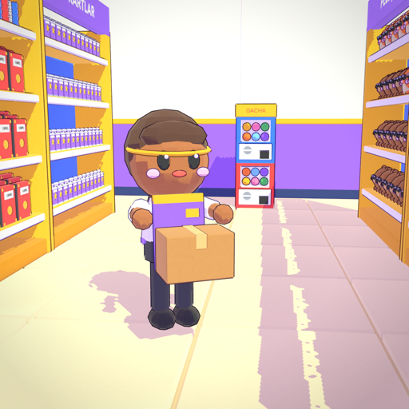
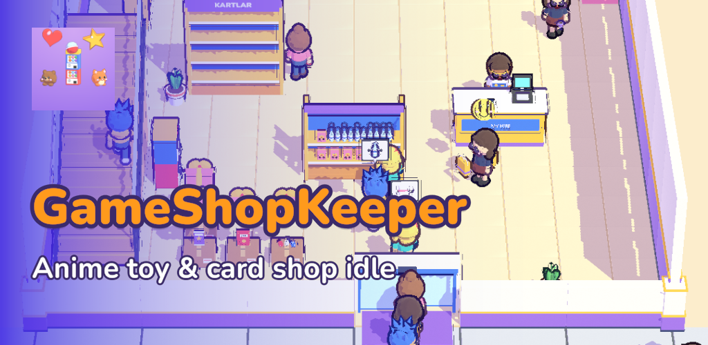
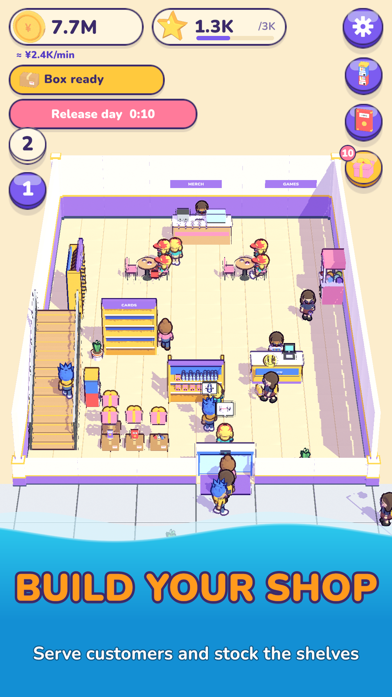
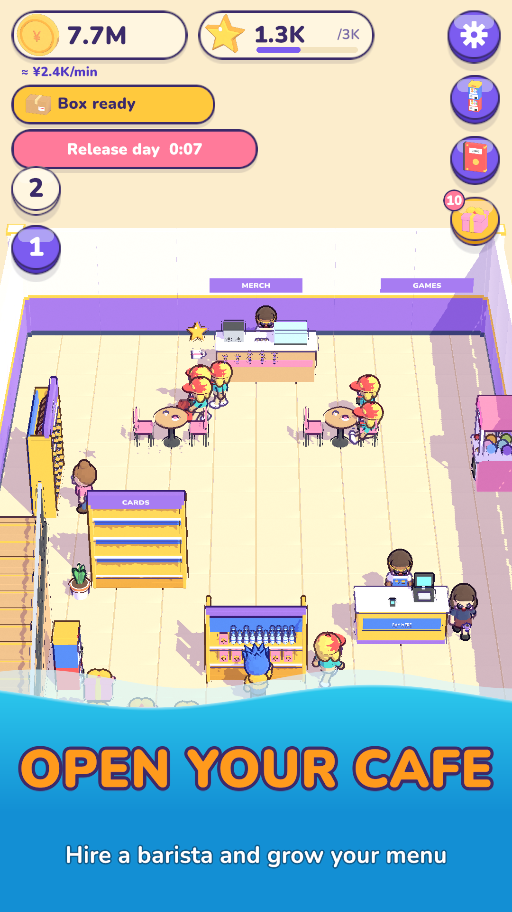
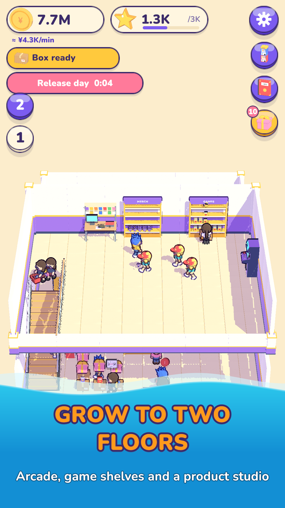
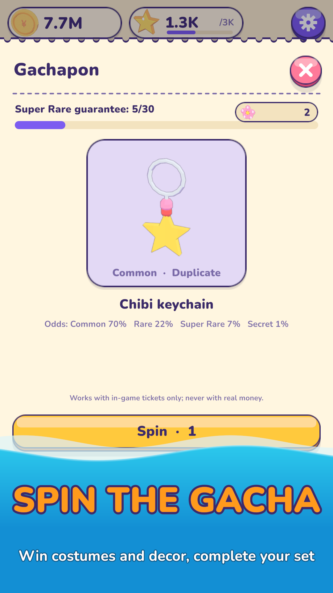
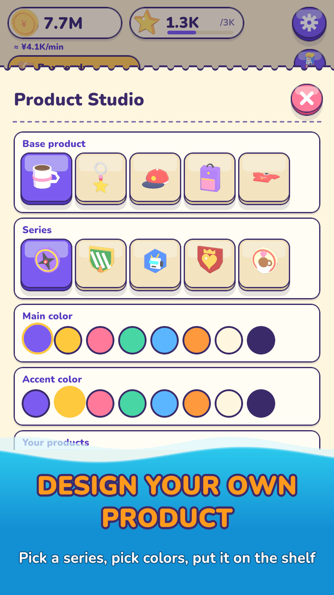
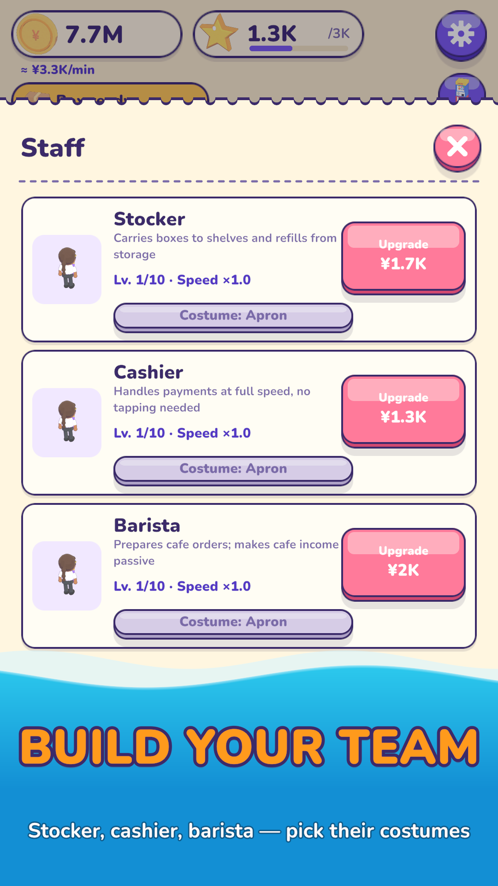
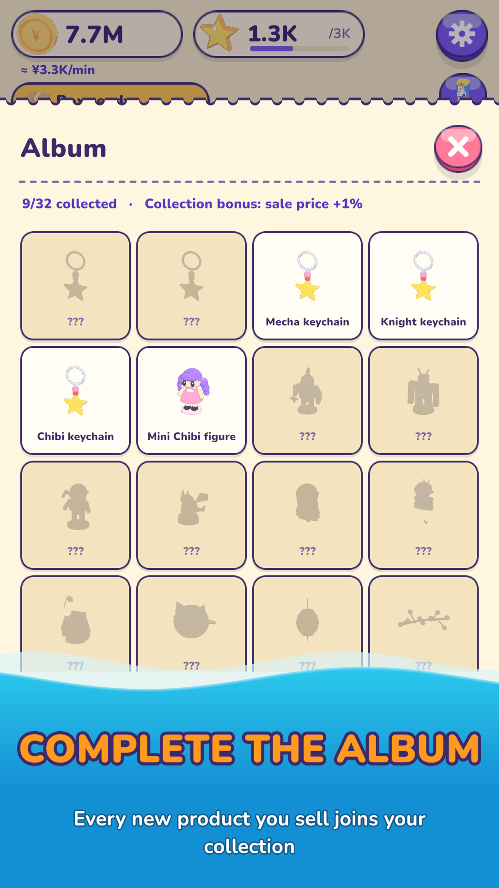
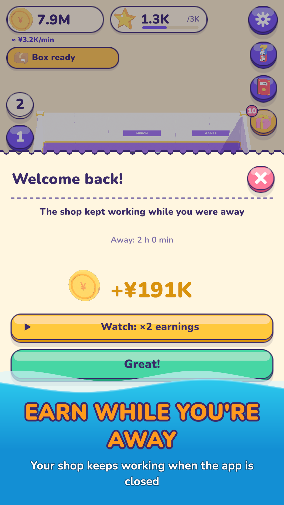

# GameShopKeeper

**Akihabara esintili bir anime / oyuncak mağazası simülatörü ve idle oyunu.**
*An Akihabara-inspired anime toy & card shop simulator and idle game.*

Unity 6 · URP Mobile · Android · Türkçe + English

> Bu depo yalnızca oyunun tanıtımıdır; kaynak kod ve oyun varlıkları yayımlanmaz.
> This repository is a showcase only; source code and game assets are not published.

## Ekran görüntüleri / Screenshots

## Oyun / About

Küçük bir köşe dükkânında kart paketi ve gachapon satarak başlarsın; müşterileri izler, rafları doldurur, mağazanı iki katlı bir mağazaya ve kafeye büyütürsün.

*Start in a tiny corner shop selling card packs and capsule toys, watch customers browse, stock the shelves and grow into a two-floor anime store with its own cafe.*

### Oyun döngüsü / Game loop

1. Sipariş ver, kamyonet gelsin, kutuları aç, ürünler rafa uçsun.
2. Müşteriler gerçekten alışveriş yapar: listesine bakar, rafı inceler, kararsız kalır, sepet doldurur, sıraya girer, öder.
3. Kasaya dokunarak ödemeyi hızlandır, Yen ve Ün kazan.
4. Rafları, kasayı, tabelayı, makineleri ve personeli yükselt; yeni aşamaya geç.

### Aşamalar / Stages

| Aşama / Stage | Alan / Area | Yeni / New |
|---|---|---|
| 1 Köşe dükkân / Corner shop | 8×8 m | kart, atıştırmalık, gachapon |
| 2 Mahalle / Neighborhood | 12×10 m | peluş, vinç makinesi, stokçu/kasiyer, gacha + albüm |
| 3 İki katlı / Two floors | + 2. kat | oyun rafları, atari, **Ürün Stüdyosu** (kendi ürününü tasarla) |
| 4 Kafe / Cafe | + 12×8 m | kafe tezgâhı, barista, menü, turnuva ve çıkış günü etkinlikleri |

### Öne çıkanlar / Highlights

- Yerleştirme modu: 0,5 m ızgara, 90° dönüş, yol tıkanma kontrolü / placement mode on a half-meter grid
- Personel ve kostümler / staff and costumes
- Gacha (30. çekilişte garanti, olasılıklar açık) ve koleksiyon albümü / gacha with a guaranteed 30th pull and a collection album
- Çevrimdışı kazanç / offline earnings
- Yalnızca oyuncu isterse ödüllü reklamlar / optional rewarded ads only
- Hesap gerekmez, çevrimdışı oynanır / no account needed, plays offline
- Kodla üretilen ses ve müzik / procedurally generated sound and music
